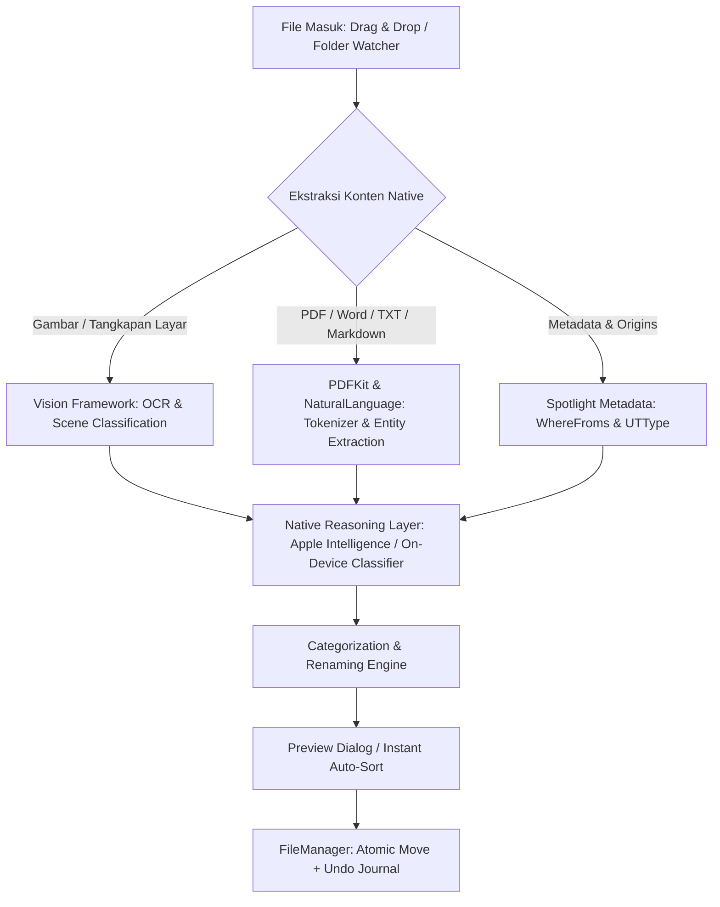

# Product Requirements Document (PRD)
## Rapihin.app — Native Lightweight File Organizer for macOS

**Status:** Draft / Ready for Review  
**Platform:** macOS 15+ (Apple Silicon Recommended)  
**Tech Stack:** Swift 6, SwiftUI, Apple Intelligence / Core ML / Vision & NaturalLanguage Frameworks  
**Architecture:** 100% Local-First, Zero External Model Downloads  

---

## 1. Executive Summary & Vision

### 1.1 Product Vision
**Rapihin** adalah aplikasi perapih file otomatis untuk macOS yang dirancang sangat ringan (*lightweight*), elegan, dan menghargai privasi pengguna secara absolut (*100% local-first*). 

Berbeda dengan solusi AI modern yang membebani sistem dengan mengunduh LLM eksternal berukuran 4GB–8GB (seperti via Ollama/Llama.cpp), **Rapihin memanfaatkan kapabilitas AI bawaan sistem operasi macOS / Apple Intelligence, Siri App Intents, serta framework bawaan Apple (Vision, NaturalLanguage, CoreSpotlight, dan PDFKit)**. 

Hasilnya adalah aplikasi berukuran mini (< 25 MB), konsumsi RAM hemat (< 60 MB idle), instan tanpa waktu unduh model, namun cerdas dalam memahami konteks file, struk tagihan, dokumen, tangkapan layar, maupun aset digital lainnya.

---

## 2. Problem Statement & User Pain Points

| Masalah Saat Ini | Solusi Rapihin |
| :--- | :--- |
| **Downloads & Desktop Clutter:** Folder Downloads dan Desktop menjadi "kuburan file" yang campur aduk. | Organisasi otomatis 1-klik atau via background scheduler ke dalam hierarki folder yang rapi. |
| **Aplikasi Rule-based (e.g. Hazel) rumit:** Mengharuskan pengguna menulis regex, script, atau rule manual yang membingungkan. | Klasifikasi semantik natural: AI memahami apakah sebuah file adalah "Invoice", "Slip Gaji", "Draft Desain", atau "Meme". |
| **Aplikasi AI Modern Boros Sumber Daya:** Harus download LLM 4GB–16GB, memakan RAM 8GB+, dan menguras baterai MacBook. | Memanfaatkan runtime on-device Apple Intelligence & native frameworks. Download size < 25MB, konsumsi baterai mendekati nol. |
| **Kekhawatiran Privasi Dokumen Sensitif:** Dokumen finansial, KTP, kontrak tidak boleh dikirim ke cloud AI. | **100% offline & on-device**, data tidak pernah meninggalkan memori perangkat. |

---

## 3. Core Architectural Principles (Local-First & Lightweight)



1. **Zero External Model Downloads:** Tidak ada download model PyTorch/GGUF/HuggingFace. Semua memanfaatkan model biner yang sudah tertanam di macOS (`Apple Foundation Models`, `VNRecognizeTextRequest`, `NLModel`, `NLLanguageRecognizer`).
2. **Apple Silicon & Core ML Optimization:** Memanfaatkan Neural Engine (ANE) bawaan chip seri M (M1–M4/M5) sehingga pemrosesan file secepat kilat tanpa membebani CPU/GPU.
3. **Atomic & Reversible Operations:** Setiap pemindahan file dicatat dalam *Journal History* lokal, memungkinkan pengguna melakukan *Undo* (Command+Z) kapan saja jika tidak sengaja salah dipindahkan.
4. **Sandboxed & macOS Security Compliant:** Memanfaatkan *Security-Scoped Bookmarks* Apple untuk izin akses folder yang aman dan transparan bagi pengguna.

---

## 4. Key Functional Features

### 4.1 Smart Context Categorization (AI Bawaan macOS)
Aplikasi membedakan dan mengkategorikan file berdasarkan konteks semantik, bukan sekadar ekstensi file:
- **Dokumen Keuangan & Finansial:** Deteksi invoice, kwitansi, bukti transfer, polis asuransi, slip gaji (via OCR Vision + Entity Extraction NaturalLanguage).
- **Tangkapan Layar & Media Kreatif:** Memisahkan tangkapan layar bug teknis, referensi desain UI, foto keluarga, wallpaper, dan aset vektor (SVG/AI/Figma).
- **Pengembangan Perangkat Lunak & Riset:** Deteksi source code, repositori tarball, dataset (.csv, .json, .parquet), dan paper ilmiah (.pdf).
- **Arsip & Installer:** Identifikasi installer `.dmg`, `.pkg`, zip yang sudah terekstrak atau kadaluarsa untuk opsi auto-cleanup/archive.

### 4.2 Entry Points & Integrasi macOS (Siri & Shortcuts)
- **Menu Bar Drop-Zone:** Ikon elegan di Menu Bar dengan animasi lembut. Pengguna cukup melempar file/folder ke Menu Bar untuk langsung dirapikan.
- **Finder Quick Actions (Services Menu):** Klik kanan pada file/folder di Finder → *"Rapihin dengan AI"*.
- **Siri & App Intents Integration:** Integrasi penuh ke aplikasi *Shortcuts* (Pintasan) dan kontrol suara Siri:
  - *"Hey Siri, rapihin folder Downloads"*
  - Dukungan parameter App Intents untuk otomatisasi workflow di Shortcuts.

### 4.3 Folder Permission & Granular Automation Engine (Auto vs Manual)
Sistem pengelolaan izin folder dan otomasi per-folder yang aman dan fleksibel:

- **Folder Access & Security-Scoped Bookmarks:**
  - Kompatibel dengan Apple App Sandbox (`com.apple.security.files.user-selected.read-write`).
  - Pengguna memberikan izin folder secara eksplisit via native macOS `NSOpenPanel`.
  - Akses disimpan secara persisten menggunakan *Security-Scoped Bookmarks* sehingga izin tetap aktif meskipun aplikasi ditutup atau Mac di-restart.
  - UI Status Izin: Indikator hijau terang (*Active*), kuning (*Re-authorization needed*), atau tombol *"Beri Izin Akses"* jika izin terlepas.

- **Mode Per-Folder: Auto vs Manual:**
  - **Mode Auto (Instant Real-Time Tidy):**
    - Menggunakan kernel event monitoring (`FSEvents` API / `DispatchSourceFileSystemObject`).
    - **In-Progress Download Guard:** Memiliki deteksi pintar untuk file yang sedang diunduh (ekstensi `.crdownload`, `.download`, `.part`) serta *write-lock stabilization* (jeda 3 detik setelah penulisan disk berhenti) agar file tidak terpotong saat diunduh browser/aplikasi lain.
    - Begitu file baru selesai ditulis seutuhnya, sistem langsung menganalisis dan memindahkannya ke kategori yang sesuai secara senyap di latar belakang.
  - **Mode Manual (On-Demand / One-Click):**
    - Folder dipantau jumlah file-nya, tetapi **TIDAK** dipindahkan otomatis.
    - Menampilkan ringkasan file pending di Menu Bar / widget (contoh: *"8 file baru di Desktop siap dirapikan"*).
    - File hanya dipindahkan saat pengguna menekan tombol *"Rapihkan Sekarang"*, via Shortcut, atau via perintah Siri.

### 4.4 Pengaturan Pengelompokan & Pengurutan (Sorting by Name / Created At)
Pengguna dapat menentukan struktur pengorganisasian di dalam folder hasil rapihan:
- **Pengelompokan Waktu Pembuatan (Created At Hierarchy):**
  - Opsi struktur tanggal fleksibel: `{Kategori}/{YYYY}/{MM}/` (contoh: `Keuangan/2026/11/Invoice-Apple.pdf`).
  - Sorting bawaan dalam folder otomatis mengikuti *Date Created* asli (atribut `btime` / `kMDItemContentCreationDate` dipertahankan secara utuh saat pemindahan).
- **Penamaan & Pengurutan Berdasarkan Nama (Name Sorting):**
  - Opsi prefix tanggal terstandar: `YYYY-MM-DD_{NamaAsli}` untuk file yang ingin selalu terurut kronologis secara alfabetis di Finder.
  - Standarisasi penamaan berbasis konteks AI (opsional, misal: merapikan nama acak tangkapan layar `Screen Shot 2026-11-08 at 20.52.png` menjadi `Screenshot_Dashboard_2026-11-08.png`).

### 4.5 Safe Reversible Execution (Anti-Data Loss)
- **Interactive Dry-Run / Tinjauan Cepat:** Menampilkan preview visual sebelum file dipindahkan (dari `Downloads/invoice_123.pdf` ke `Documents/Keuangan/2026/Invoice/`).
- **One-Click Instant Undo:** Kemampuan mengembalikan semua file yang baru saja dirapikan ke lokasi asalnya.
- **Conflict Handling Cerdas:** Jika terdapat nama file kembar, sistem otomatis menyematkan timestamp semantik (misal: `Kontrak_Kerja (Nov 2026).pdf`), bukan menimpa file (*never overwrite*).

### 4.6 Autostart saat Login (Launch at Login Engine)
- **Modern ServiceManagement (`SMAppService`):** Menggunakan API resmi Apple `SMAppService.mainApp` (menggantikan cara legacy plist/LoginItem yang rawan diblokir sistem).
- **Silent Background Initialization:** Saat Mac dinyalakan dan user login, aplikasi langsung aktif senyap di Menu Bar tanpa memunculkan jendela popup yang mengganggu layar kerja.
- **Instant Watcher Restoration:** Saat autostart berjalan, sistem secara otomatis me-reload semua *Security-Scoped Bookmarks* dan mengaktifkan kembali `FSEvents` watcher untuk folder berstatus **Auto**, sehingga file unduhan langsung terlindungi dan tertata sejak detik pertama Mac menyala.
- **System Settings Sync:** Terdaftar secara resmi dan transparan di menu bawaan macOS: *System Settings > General > Login Items & Extensions*.

---

## 5. UI/UX Design System (Gaya macOS Modern & Futuristik)

Aplikasi mengusung estetika visual macOS generasi baru:

### 5.1 Karakteristik Visual
- **Translucent Vibrancy / Liquid Glass:** Penggunaan material glassmorphism modern dengan background blur native (`.ultraThinMaterial`), border gradasi halus (0.5pt stroke semi-transparan).
- **Tipografi & Ikon:** Menggunakan *SF Pro Rounded* untuk aksen yang ramah dan *SF Symbols 6+* dengan rendering mode multitone / hierarkis.
- **Fluid Micro-Interactions:** Animasi berbasis spring physics (`.spring(response: 0.35, dampingFraction: 0.8)`) saat file di-drag ke atas zona drop.

### 5.2 Struktur Antarmuka

```
┌───────────────────────────────────────────────────────────┐
│  Rapihin                 [Preview]  [Aktivitas]  [⚙ Setelan]  │
├───────────────────────────────────────────────────────────┤
│                                                           │
│    ┌ ─ ─ ─ ─ ─ ─ ─ ─ ─ ─ ─ ─ ─ ─ ─ ─ ─ ─ ─ ─ ─ ─ ─ ─ ─ ┐  │
│      Taruh File atau Folder di Sini                      │
│    │                  ✨                                │  │
│      Analisis pintar dengan AI bawaan Mac                │
│    └ ─ ─ ─ ─ ─ ─ ─ ─ ─ ─ ─ ─ ─ ─ ─ ─ ─ ─ ─ ─ ─ ─ ─ ─ ─ ┘  │
│                                                           │
│  📂 Target Otomatis: ~/Documents/Rapi/                    │
│  ⚡ Menunggu 14 file di Downloads...   [ Rapihkan Sekarang ]│
└───────────────────────────────────────────────────────────┘
```

### 5.3 Menu Setelan (Settings Window) yang Intuitif
Menu Preferences dirancang dalam gaya modern macOS Settings pane (Sidebar navigation):

1. **Folder & Izin Akses (Folders & Permissions):**
   - **Tabel Kelola Folder:** Menampilkan daftar folder target (contoh: `~/Downloads`, `~/Desktop`, atau custom folder).
   - **Status Izin (Permission Status):** Indikator badge native ("✓ Diizinkan" / "⚠️ Butuh Izin Akses") dengan tombol 1-klik untuk memberikan izin via sandboxed file dialog.
   - **Mode Operasi per Folder:** Switch/Segmented Picker untuk setiap folder: `[ Otomatis (Real-time) ]` vs `[ Manual (Sesuai Permintaan) ]`.
   - **Target Output:** Folder tujuan hasil rapihan (misal: `~/Documents/Organized/` atau diatur spesifik per folder asal).

2. **Pengurutan & Struktur (Sorting & Organization Structure):**
   - **Hierarki Folder Tujuan:** Pilihan skema subfolder:
     - `Kategori Saja` (`/Dokumen/`)
     - `Kategori > Tahun > Bulan` (`/Dokumen/2026/11/`)
     - `Tahun > Kategori` (`/2026/Dokumen/`)
   - **Aturan Pengurutan File (File Sorting):**
     - Urutkan berdasarkan `Created At` asli file (mempertahankan timestamp awal).
     - Standarisasi nama file alfabetis (`[YYYY-MM-DD] Nama File`).
     - Pembersihan nama file otomatis (opsional: hilangkan trailing `(1)`, `copy`, atau format timestamp screenshot acak).

3. **Kategori & Aturan AI (Categories & Rules):**
   - Toggle kategori aktif: Dokumen Kerja, Finansial & Tagihan, Media & Foto, Installer, Kode & Proyek.
   - Fitur "Bahasaku Sendiri": Instruksi natural language sederhana untuk aturan khusus (misal: *"Semua dokumen dengan kata 'Skripsi' taruh di folder Kuliah"*).

4. **Umum & Mulai Otomatis (General & Autostart):**
   - **Buka Otomatis saat Login (Launch at Login):** Toggle native terintegrasi dengan `SMAppService`.
   - **Mulai Senyap (Start Minimized):** Opsi agar aplikasi langsung sembunyi di Menu Bar tanpa membuka jendela utama saat Mac dinyalakan.
   - **Mode Tampilan:** `Menu Bar Saja` (rekomendasi untuk kesan ultra-ringan) atau `Dock + Menu Bar`.
   - **Notifikasi & Suara:** Toggle notifikasi senyap/banner saat batch file selesai dirapikan, serta efek suara subtle / haptic trackpad.

5. **Riwayat & Pulihkan (History & Undo):**
   - Log visual semua batch perapihan terakhir lengkap dengan tombol *"Pulihkan Batch Ini"*.

---

## 6. Technical Specifications

### 6.1 System Requirements
- **OS Support:** macOS Sequoia 15.0+ (dan kompatibel dengan versi macOS masa depan).
- **Hardware:** Apple Silicon (M1/M2/M3/M4 atau lebih baru) untuk pemanfaatan ANE (Apple Neural Engine).
- **Storage Footprint:** < 25 MB disk space (termasuk asset icon dan local database).
- **Memory Footprint:** 35 MB – 50 MB idle; maks 120 MB saat batch processing 1.000 file.

### 6.2 Tech Stack & Framework Matrix

| Komponen | Framework / Teknologi | Alasan Pemilihan |
| :--- | :--- | :--- |
| **UI Layer** | SwiftUI (macOS 15+) | Performa native 120fps (ProMotion), integrasi tema sistem otomatis. |
| **AI / NLP** | `NaturalLanguage`, `WritingTools` / Apple Foundation Models | Ekstraksi entitas teks, klasifikasi sentimen/topik tanpa memori tambahan. |
| **Vision / OCR** | `Vision` (`VNRecognizeTextRequest`) | OCR on-device super cepat dengan akselerasi hardware. |
| **App Intents** | `AppIntents` Framework | Integrasi mulus dengan Siri, Spotlight, dan aplikasi Shortcuts. |
| **File Indexing** | `CoreSpotlight`, `UniformTypeIdentifiers` | Identifikasi tipe MIME dan metadata file secara instan. |
| **Autostart Service** | `ServiceManagement` (`SMAppService`) | Standar resmi macOS 13+ untuk autostart login items tanpa helper daemons rumit. |
| **Data Persistence** | `SwiftData` / SQLite lokal | Menyimpan log perapihan, setting pengguna, dan state undo secara efisien. |

---

## 7. Metrics & Success Criteria

1. **Performance:** Pemrosesan 100 file campuran (PDF, gambar, zip, dokumen) selesai di bawah **3 detik**.
2. **Resource Impact:** Pemakaian RAM tidak melebihi 150 MB pada beban puncak, 0% CPU saat tidak ada file yang diproses.
3. **User Friction:** Pengguna baru dapat memahami dan mengaktifkan perapihan folder pertama dalam waktu kurang dari **45 detik**.
4. **Accuracy:** Tingkat akurasi kategorisasi semantik dokumen di atas **95%**.

---

## 8. Milestone & Execution Roadmap

- **Milestone 1 (Foundations & Engine):**
  - Implementasi Swift File Scanner & Security-Scoped Bookmark management.
  - Integrasi Vision OCR & NaturalLanguage pipeline untuk klasifikasi teks/gambar.
  - Implementasi safe atomic file mover dengan Undo history.
- **Milestone 2 (UI & Native Experience):**
  - Pembuatan Menu Bar widget & Modern Translucent Drop-zone UI.
  - Implementasi Settings window dengan sidebar navigation bergaya macOS modern.
- **Milestone 3 (Apple Ecosystem Integration):**
  - Integrasi App Intents untuk Shortcuts & Siri voice commands.
  - Integrasi Finder Contextual Menu (Quick Action).
  - Background idle file watcher & batch notification generator.
