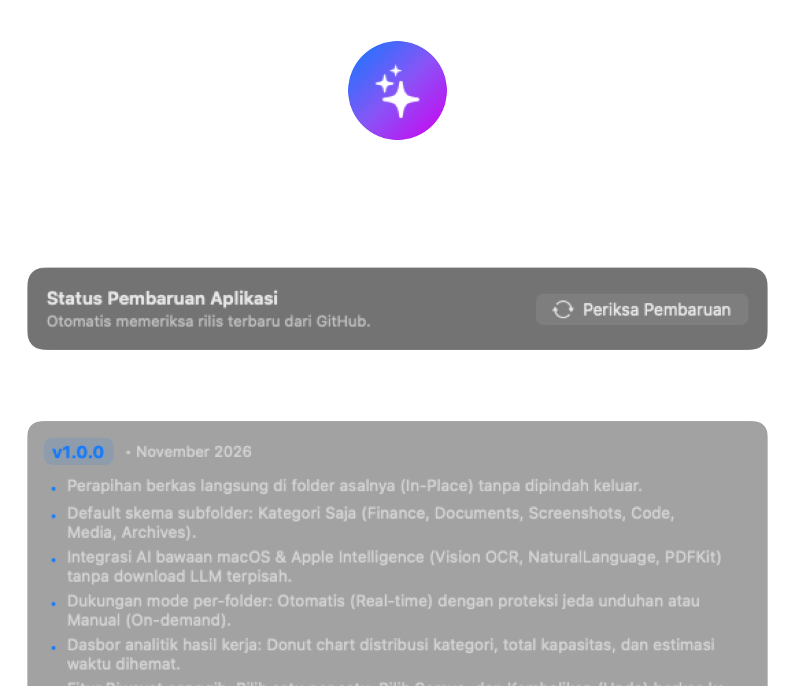

<div align="center">


# ✨ Rapihin.app
### *Smart, Ultra-Lightweight & Local-First File Organizer for macOS*
**Perapih File Otomatis Cerdas Berbasis AI Bawaan macOS & Apple Intelligence**

[](https://www.apple.com/macos)
[](https://swift.org)
[](https://apple.com)
[](https://github.com/ardith666/rapihin)
[](https://github.com/ardith666/rapihin)
[](LICENSE)

<br/>

[🍺 Install via Homebrew](#-instalasi-via-homebrew-cask) • [🇮🇩 Bahasa Indonesia](#-fitur-utama--tentang-rapihin) • [🇬🇧 English](#-overview--features-english) • [🚀 Cara Pemakaian](#-panduan-penggunaan-cara-pemakaian)

---

</div>

## 🍺 Instalasi via Homebrew Cask

Instal Rapihin secara instan via Homebrew Tap:

```bash
# Tambahkan tap ardith666/tap
brew tap ardith666/tap

# Instal aplikasi
brew install --cask rapihin
```

Atau cukup 1 baris perintah:
```bash
brew install --cask ardith666/tap/rapihin
```

Atau unduh berkas installer `Rapihin-1.0.0.dmg` langsung dari [Halaman Rilis GitHub](https://github.com/ardith666/rapihin/releases).

## 📸 Antarmuka Aplikasi (Screenshots)

<div align="center">

### 🖥️ Dashboard, Drop Zone & Analisis Hasil Kerja
*Area rapih instan dengan estetika modern macOS, indikator berkas tertunda, dan grafik analitik distribusi pekerjaan.*


<br/>

| 📁 Kelola Folder & Mode Otomatis | ⚙️ Pengaturan & Bahasa |
| :---: | :---: |
|  |  |
| *Izin folder fleksibel, toggle Auto vs Manual* | *Autostart saat login, bilingual ID/EN, skema folder* |

<br/>

| 🕒 Riwayat, Multi-Pilih & Pulihkan | ℹ️ Tentang, Pembaruan & Changelog |
| :---: | :---: |
|  |  |
| *Pilih satu per satu, Pilih Semua & Kembalikan* | *Auto-update check GitHub rilis & histori versi* |

</div>

---

## 🇮🇩 Fitur Utama & Tentang Rapihin

**Rapihin** adalah aplikasi perapih file untuk macOS yang dirancang sangat ringan (*ultra-lightweight*), elegan dengan estetika modern macOS, dan menghargai privasi pengguna secara absolut (**100% local-first**).

Berbeda dari aplikasi AI lain yang mengharuskan Anda mengunduh model LLM eksternal sebesar 4GB–16GB (yang menguras memori dan baterai MacBook), **Rapihin memanfaatkan langsung kapabilitas AI bawaan sistem operasi macOS (Apple Intelligence, Vision OCR `VNRecognizeTextRequest`, NaturalLanguage semantic tokenizer, dan PDFKit)**.

### 🌟 Keunggulan Utama:
- 🪶 **Sangat Ringan (< 2 MB):** Ukuran aplikasi hanya ~1.4 MB, pemakaian RAM idle hanya ~40 MB. Bebas dari bengkak (*zero bloat*).
- 🧠 **AI Bawaan macOS (Zero LLM Download):** Memahami konteks invoice, kuitansi, bukti transfer, slip gaji, tangkapan layar, kode proyek, arsip, dan dokumen kerja secara instan tanpa internet dan tanpa unduh model tambahan.
- 📁 **Rapi Langsung di Tempat (In-Place):** Berkas tetap berada di folder asalnya (misal `Downloads` atau `Desktop`) dan dikelompokkan ke dalam subfolder kategori di dalamnya (default: **Kategori Saja** tanpa memindahkan berkas ke folder luar).
- 📊 **Analisis Hasil Kerja:** Grafik donut chart visual distribusi kategori berkas yang berhasil dirapikan, total kapasitas tertata, serta estimasi waktu yang dihemat.
- 📂 **Izin Folder & Mode Per-Folder (Auto vs Manual):**
  - **Mode Otomatis (Real-time):** Memantau folder secara senyap. Setiap ada file baru masuk, otomatis dikategorikan. Dilengkapi proteksi jeda unduhan agar file tidak terpotong saat masih diunduh browser.
  - **Mode Manual (On-demand):** Folder dipantau jumlah berkasnya, namun hanya dipindahkan ketika Anda menekan tombol *"Rapikan Sekarang"*.
- ⏱️ **Pengurutan Fleksibel (Created At vs Name):**
  - Opsi susunan folder: Default **Kategori Saja** (`Finance`, `Documents`, `Screenshots`, dll) dengan opsi hierarki waktu.
  - Mempertahankan tanggal pembuatan asli (`Created At`) dan opsi otomatis menyematkan tanggal standar `YYYY-MM-DD` pada nama file.
- 🔄 **Multi-Pilih & 1-Click Undo di Riwayat:** Pilih berkas satu per satu, gunakan tombol **Pilih Semua**, dan **Kembalikan Terpilih** atau **Kembalikan Semua** untuk memulihkan berkas ke posisi asal seketika.
- 🚀 **Autostart saat Login (Launch at Login):** Terintegrasi langsung dengan framework modern Apple `SMAppService.mainApp` untuk boot senyap di Menu Bar saat Mac menyala.
- 🆙 **Cek Pembaruan Otomatis & Changelog:** Memeriksa rilis terbaru dari GitHub secara langsung di menu Tentang lengkap dengan riwayat versi.
- 🌐 **Dua Bahasa (Bilingual UI):** Beralih dengan mudah antara **Bahasa Indonesia 🇮🇩** dan **English 🇬🇧** langsung dari menu pengaturan.

---

## 🇬🇧 Overview & Features (English)

**Rapihin** is an intelligent, privacy-first file organizer built natively in Swift for macOS. It cleans up cluttered folders like `Downloads` and `Desktop` by categorizing documents, receipts, screenshots, media, and code using **Apple's on-device Intelligence, Vision, and NaturalLanguage frameworks**.

- ⚡ **Zero External Models Needed:** No 8GB LLM downloads, no Ollama daemon running in the background. Runs entirely on Apple Silicon Neural Engine (ANE).
- 📁 **In-Place Organization:** Keeps files in their original folders and categorizes them into category subfolders by default (`Category Only`).
- 📊 **Work Performance Analytics:** Interactive donut chart and KPI stats showcasing files organized, storage sorted, and time saved.
- 📦 **Compact & Native:** Compiled native binary size is just ~1.4 MB with a minimal ~40 MB idle RAM footprint.
- 🔄 **Real-Time Watcher or On-Demand:** Configure each folder as either *Auto* (instant sorting on arrival with download-completion guards) or *Manual* (tidy with one click).
- ↩️ **Batch Reversible Moves (Undo):** Select individual items, *Select All*, and restore selected files back to their original locations.
- 🆙 **Auto-Update & Changelog:** In-app release checker via GitHub API and version history view.
- 🇬🇧 🇮🇩 **Bilingual System:** Switch seamlessly between English and Bahasa Indonesia.

---

## 🚀 Panduan Penggunaan (Cara Pemakaian)

### 1. Menjalankan Aplikasi
Buka aplikasi `Rapihin.app`. Anda akan disambut oleh jendela utama dengan area Drop Zone yang elegan, serta ikon Menu Bar di bagian atas status bar Mac Anda.

### 2. Mengatur Folder Pantauan
1. Buka tab **Kelola Folder** (*Folders*).
2. Klik **Tambah Folder...** dan pilih folder yang ingin dirapikan (misal: `Downloads` atau `Desktop`).
3. Berikan izin akses via dialog native macOS.
4. Pilih mode untuk folder tersebut:
   - Pilih **Otomatis (Real-time)** jika Anda ingin file yang baru diunduh langsung dirapikan ke subfolder kategori.
   - Pilih **Manual** jika Anda ingin mengumpulkan berkas terlebih dahulu dan merapikannya secara berkala.

### 3. Merapikan dengan Drag & Drop
Cukup tarik (*drag*) satu atau beberapa berkas/folder langsung ke area **Drop Zone** di Beranda. AI bawaan Mac akan mengekstrak konten dan memindahkannya seketika ke folder tujuan.

### 4. Mengubah Format Pengurutan & Bahasa
1. Buka tab **Pengaturan** (*Settings*).
2. Pilih bahasa: **Bahasa Indonesia 🇮🇩** atau **English 🇬🇧**.
3. Atur struktur subfolder yang Anda inginkan (misal: `Kategori > Tahun > Bulan`).
4. Aktifkan **Mulai Otomatis saat Login** agar Rapihin selalu menjaga kebersihan Mac Anda sejak dinyalakan.

### 5. Membatalkan Pemindahan (Undo)
Jika ada berkas yang salah tempat atau ingin dikembalikan ke lokasi asalnya:
1. Buka tab **Riwayat & Pulihkan** (*History & Undo*).
2. Klik tombol **Kembalikan (Undo)** di sebelah berkas yang bersangkutan. Berkas akan kembali ke lokasi awalnya secara instan.

---

## 🛠️ Cara Instalasi & Kompilasi

### Prasyarat
- macOS 14.0 (Sonoma) atau lebih baru (macOS 15+ Sequoia / macOS 27 direkomendasikan).
- Apple Silicon Mac (M1/M2/M3/M4/M5) atau Mac berbasis Intel.
- Xcode 15+ atau Command Line Tools dengan Swift 6.0+.

### Kompilasi dari Source Code

```bash
# 1. Clone repositori
git clone https://github.com/ardith666/rapihin.git
cd rapihin

# 2. Jalankan test otomatis
swift test

# 3. Bangun bundel aplikasi Rapihin.app
./scripts/build_app.sh

# 4. Buka aplikasi
open Rapihin.app
```

Untuk memindahkan ke folder Applications Anda:
```bash
cp -R Rapihin.app /Applications/
```

---

## 🏗️ Struktur Arsitektur

```
Rapihin/
├── Package.swift               # Definisi Swift Package Manager (macOS target)
├── PRD.md                      # Product Requirements Document lengkap
├── scripts/
│   └── build_app.sh            # Skrip otomatisasi build & codesign bundel .app
├── docs/
│   └── screenshots/            # Tangkapan layar antarmuka aplikasi
└── Sources/Rapihin/
    ├── App/
    │   └── Rapihin.swift       # Entry point (@main) & MenuBarExtra
    ├── Models/
    │   ├── AppSettings.swift   # Pengaturan aplikasi & preferensi bahasa
    │   ├── FileCategory.swift  # Kategori cerdas (Finance, Docs, Code, dll)
    │   ├── MonitoredFolder.swift # Model folder & state izin keamanan
    │   └── OrganizedItem.swift # Model riwayat & data undo
    ├── Services/
    │   ├── AIClassifier.swift  # Ekstraksi Vision OCR, NaturalLanguage, & PDFKit
    │   ├── AutostartManager.swift # Integrasi SMAppService macOS
    │   ├── FolderWatcher.swift # DispatchSource kernel event watcher & debounce
    │   ├── LocalizationManager.swift # Manajemen terjemahan ID & EN
    │   └── OrganizerEngine.swift # Mesin pemindah file atomik & undo journal
    └── Views/
        ├── DropZoneView.swift  # Komponen drop-zone interaktif
        ├── FolderManagementView.swift # Pengelolaan izin & mode Auto/Manual
        ├── HistoryView.swift   # Tampilan log riwayat & pembatalan
        ├── MainView.swift      # Dasbor utama dengan gaya liquid glass
        ├── MenuBarView.swift   # Popover menu bar macOS
        └── SettingsView.swift  # Jendela preferensi sistemik tabbed
```

---

## 📄 Lisensi

Proyek ini dilisensikan di bawah lisensi **MIT** - lihat berkas [LICENSE](LICENSE) untuk informasi lebih lanjut.

Dibuat dengan ❤️ untuk ekosistem macOS yang bersih, cepat, dan menghargai privasi.
